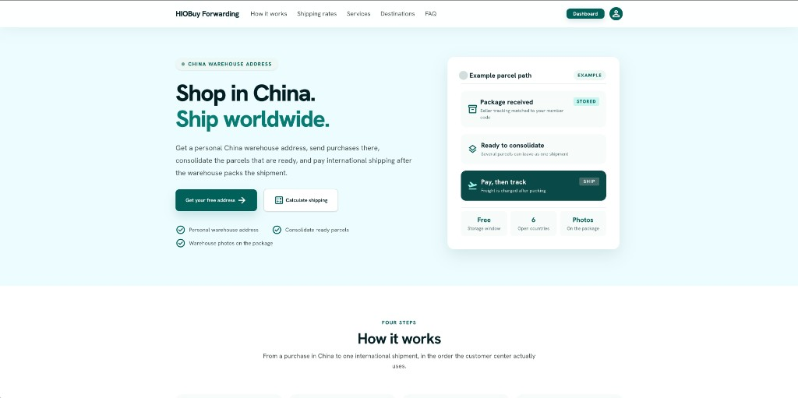
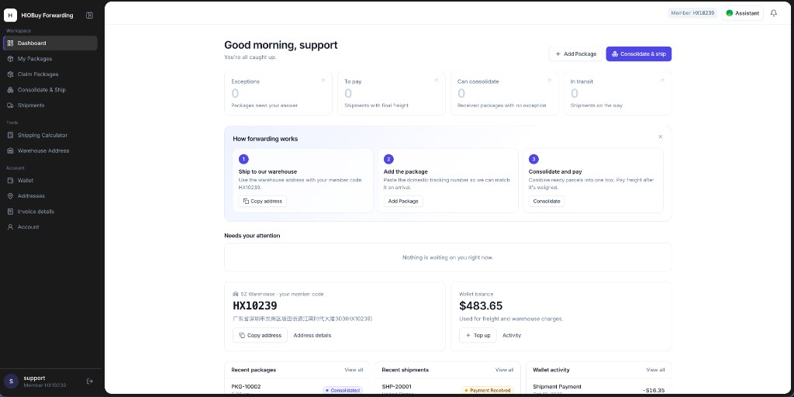
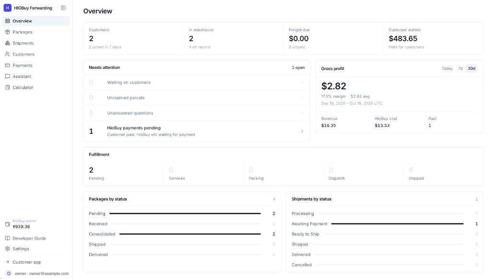

# HioBuy Forwarding

**Open-Source Parcel Forwarding & Package Consolidation Platform**

HioBuy Forwarding is a self-hosted, white-label web application for running a China-based parcel forwarding business. It gives your customers a portal for pre-alerts, consolidation, payment, and tracking, and gives your team an admin console for pricing, payments, and operations. Physical warehouse work is done by the [HioBuy Fulfillment API](https://hiobuy.com/en/api-docs/fulfillment-setup).

You own the customer relationship, branding, selling prices, and customer payments. HioBuy receives, stores, packs, and ships the parcels.

**[Live demo](https://forwarding.demo.hiobuy.com)** · **[Repository](https://github.com/hiobuy/forwarding)** · **[HioBuy](https://hiobuy.com)** · **[Fulfillment API docs](https://hiobuy.com/en/api-docs/fulfillment-setup)**

> **Status:** v1.0.0. The application runs in production on Cloudflare Workers. Read [Known limitations](#known-limitations) and the [Production checklist](docs/getting-started/production.md) before you accept real customers.

## Contents

- [Project introduction](#project-introduction)
- [Key features](#key-features)
- [Live demo](#live-demo)
- [Screenshots](#screenshots)
- [How it works](#how-it-works)
- [Architecture](#architecture)
- [Technology stack](#technology-stack)
- [Getting started](#getting-started)
- [Environment configuration](#environment-configuration)
- [Local development](#local-development)
- [Cloudflare deployment](#cloudflare-deployment)
- [Developer documentation](#developer-documentation)
- [White-label customization](#white-label-customization)
- [Security](#security)
- [License](#license)

## Project introduction

A forwarding business needs much more than a shipping calculator: customer accounts, warehouse addresses, package pre-alerts, warehouse status sync, consolidation, live quotes with your own markup, payments, tracking, invoices, and staff tools. HioBuy Forwarding puts these into one application that you can deploy under your own brand and extend.

It is built for independent forwarders, buying agents, logistics resellers, and developers who build forwarding services on top of HioBuy warehouses.

HioBuy Forwarding is a customer business platform. It is **not** a warehouse management system. It never weighs, packs, or ships anything itself.

## Key features

### Customer portal

- Email and password registration with email verification. Optional Google sign-in and Cloudflare Turnstile
- A personal warehouse address with the customer's member code, shown once the warehouse is synced from HioBuy
- Package pre-alerts (up to 30 at a time), with cancel and delete while a package is still `PENDING`
- Claims for unidentified packages, and responses to package exceptions
- Package photos and videos returned by the HioBuy warehouse
- Consolidation into one shipment with a live quote for the chosen packages and address
- Checkout from a USD wallet or with Stripe Checkout
- Wallet top-up by Stripe or by bank transfer that your team confirms
- Shipment tracking, address book, invoice details, and downloadable shipping documents
- In-app notifications and email preferences
- An optional signed-in assistant on Workers AI that can look things up and, after the customer confirms, pre-alert, claim, or consolidate

### Admin console

- Overview of customers, stock, freight due, wallet totals, queues, and freight profit
- Package and shipment management, with manual pulls from HioBuy and signed HioBuy webhooks
- HioBuy Pay for fulfillment freight after the customer has paid, with optional two-factor confirmation
- Shipment cancel and interception through HioBuy
- Customers and manual wallet adjustments with a recorded reason
- Payments: Stripe payments, bank top-up review, refunds, and disputes
- One global markup, fixed fee, and exchange rate. Cost and profit snapshots per shipment
- Destination country switches, read-only HioBuy fulfillment wallet, and an admin calculator that shows cost and profit
- SMTP email and editable templates, invoicing, tracking labels, business profile, and branding
- Staff roles (owner, manager, support) with per-route permissions
- A Developer Guide rendered inside the admin at `/admin/guide`

## Live demo

The public demo runs at **https://forwarding.demo.hiobuy.com**. You can browse the public website, use the shipping calculator, and register a customer account.

The public demo runs with `DEMO_MODE=true`, so any signed-in user can open the read-only Demo Admin at `/admin/demo`. It shows a fixed sample catalog. In demo mode the deployment sends no email, the calculator returns sample prices, and HioBuy Pay is refused. Email sign-up therefore cannot be verified on the demo; Google sign-in works when it is configured.

Balances, prices, and transactions on the demo are not real financial or logistics records. Do not send real parcels to an address shown on the demo unless you have an agreement with HioBuy.

## Screenshots

**Public website.** The built-in marketing site with a shipping calculator (`PUBLIC_SITE_MODE=integrated`).



**Customer portal.** The dashboard with the customer's warehouse address, member code, wallet, and recent packages and shipments.



**Admin console.** The operator overview with queues, gross profit, fulfillment progress, and the HioBuy wallet balance.



## How it works

1. **Register.** The customer signs up and receives a member code.
2. **Pre-alert.** The customer registers domestic tracking numbers. This app sends an inbound notice to HioBuy. The package stays `PENDING`.
3. **Receive.** The HioBuy warehouse receives the parcel. Status, weight, dimensions, and photos come back by pull or webhook (`RECEIVED`).
4. **Consolidate.** The customer chooses packages and an address. HioBuy quotes the channels. This app adds your markup and converts to USD.
5. **Customer payment.** The customer pays you, from the USD wallet or through Stripe.
6. **Fulfillment payment.** Your team pays HioBuy from your HioBuy fulfillment wallet (HioBuy Pay).
7. **Ship and deliver.** HioBuy dispatches the shipment (`SHIPPED`), and tracking flows back until it is signed for (`SIGNED`).

Customer payment and HioBuy payment are separate. A customer can have paid while HioBuy still shows `UNPAID`. That is normal, and it does not mean the shipment is ready to leave.

Package lifecycle: `PENDING` → `RECEIVED` → `CONSOLIDATED` → `SHIPPED` → `DELIVERED`, with side states `TRANSFERRING`, `DISCARDED`, `UNCLAIMED`, and `ARCHIVED`. Package condition (`NORMAL` / `EXCEPTION`) is a separate field.

Shipment lifecycle on HioBuy: `PENDING`, `WAIT_PAYMENT`, `WAIT_SHIP`, `SHIPPED`, `SIGNED`, `CANCELLED`. HioBuy `payment_status`, interception status, and this app's sync status are tracked separately. See the [Status reference](docs/statuses/packages.md).

## Architecture

| HioBuy Forwarding (this app) | HioBuy Fulfillment |
| --- | --- |
| Customer accounts and staff | Warehouse receiving and storage |
| Pre-alerts and claims | Inspection, photos, and exceptions |
| Customer-facing shipments | Packing and consolidation |
| Selling price, markup, and exchange rate | Channel cost quotes |
| USD customer wallet and customer payments | CNY fulfillment wallet |
| Invoices, notifications, and reporting | International dispatch and tracking |

```text
Browser (React)
  → Hono API on Cloudflare Workers  (/api/*)
    → domain rules (src/domain) and services (server)
      → Cloudflare D1, R2
      → server/services/hiobuy  → HioBuy Fulfillment API
```

The browser only calls this app. The HioBuy API key stays in the Worker. Eligibility, prices, payable amounts, and profit are computed on the server. Prices, costs, or discounts sent by a client are never trusted. Guest and customer responses never include cost or markup.

More detail: [Implementation notes](docs/architecture.md) and [System architecture](docs/architecture/system.md).

## Technology stack

| Layer | Technology |
| --- | --- |
| Frontend | React 19, TypeScript, Vite, React Router, TanStack Query |
| Styling | Tailwind CSS |
| Backend | Hono on Cloudflare Workers |
| Database | Cloudflare D1 with Drizzle ORM |
| Files | Cloudflare R2 |
| Validation | Zod |
| Authentication | Better Auth |
| Payments | Stripe Checkout, bank transfer |
| Email | SMTP over Workers TCP sockets |
| Assistant | Cloudflare Agents, Durable Objects, Workers AI |
| Tests | Vitest |

## Getting started

### Requirements

- Node.js 20 or newer, and npm
- A Cloudflare account, for deployment
- A HioBuy developer account with a warehouse fulfillment API key, for live warehouse data and quotes. HioBuy subscriptions, warehouse services, and freight are billed by HioBuy and are not part of this repository

### Install and run

```bash
git clone https://github.com/hiobuy/forwarding.git
cd forwarding
npm install
cp .dev.vars.example .dev.vars
openssl rand -base64 32   # paste the result into BETTER_AUTH_SECRET in .dev.vars
npm run dev
```

`npm run dev` applies the local D1 migrations, then serves the pages and the API. Open the URL printed in the terminal.

1. Register with the email you put in `ADMIN_EMAILS`. Without SMTP, the verification link appears on the verify page (development only).
2. Open `/admin`. That account becomes the first owner.
3. Go to **Settings → Integration** and save a HioBuy API key, then sync the warehouse and destinations.
4. Set **Settings → Pricing** and enable countries in **Settings → Destinations**.
5. Try a quote at `/app/shipping-calculator`.

Until the warehouse is synced, customers see no warehouse address. Local placeholder data is never presented as live HioBuy data.

## Environment configuration

Local values live in `.dev.vars`, which is ignored by Git. Production secrets are set with `wrangler secret put`. The full list with comments is in [`.dev.vars.example`](.dev.vars.example).

| Variable | Required | Purpose |
| --- | --- | --- |
| `BETTER_AUTH_SECRET` | Yes | Session signing, and the key for secrets saved from the admin |
| `ADMIN_EMAILS` | First run | Promotes the first owner. After that, Settings → Team manages staff |
| `HIOBUY_API_TOKEN` | No | Fallback HioBuy key. A key saved in Settings → Integration wins |
| `PUBLIC_SITE_MODE` | No | `integrated` (default) or `app-only` |
| `PUBLIC_WEBSITE_URL` | No | External marketing site for the logo, return link, and email footer |
| `DEMO_MODE` | No | `true` opens the read-only Demo Admin and turns off email, live quotes, and HioBuy Pay. Leave unset for a real business. Set it with `wrangler secret put`, not in `wrangler.jsonc` |
| `SMTP_*` | No | Override Settings → Email |
| `GOOGLE_CLIENT_ID`, `GOOGLE_CLIENT_SECRET` | No | Override Google sign-in in Settings → Advanced |
| `TURNSTILE_SITE_KEY`, `TURNSTILE_SECRET_KEY` | No | Override Turnstile in Settings → Advanced |
| `APP_URL`, `BUSINESS_NAME`, `BUSINESS_EMAIL`, `TRUSTED_APP_ORIGINS` | No | Defaults until Settings → Business is saved |
| `CUSTOMER_AI_ENABLED` | No | Locks the customer assistant on or off |

Stripe keys, the bank account, the HioBuy webhook signing secret, and email templates are configured in the admin and stored in D1. `ENVIRONMENT` is set in `wrangler.jsonc` and must be `production` in production.

## Local development

| Command | What it does |
| --- | --- |
| `npm run dev` | Migrate local D1, then start Vite and the local Worker |
| `npm run test` | Vitest over `src/domain` and `server` tests |
| `npm run typecheck` | TypeScript project check |
| `npm run build` | Production build |
| `npm run db:generate` | Generate a Drizzle migration after a schema change |
| `npm run db:migrate` | Apply migrations to local D1 |
| `npm run db:reset` | Wipe and recreate local D1 |
| `npm run cf-typegen` | Regenerate `worker-configuration.d.ts` |

Project layout, routes, API conventions, and "where to change" notes are in [Local development](docs/development.md).

## Cloudflare deployment

1. Create a D1 database and an R2 bucket named `hiobuy-forwarding-photos`.
2. In `wrangler.jsonc`, set your own `database_id` and route in the `env.production` block. The values in this repository belong to the HioBuy demo and will not work in your account.
3. Set secrets:

   ```bash
   npx wrangler secret put BETTER_AUTH_SECRET --env production
   npx wrangler secret put ADMIN_EMAILS --env production
   ```

4. Apply migrations and deploy:

   ```bash
   npm run db:migrate:remote
   npm run deploy
   ```

5. Configure Settings → Integration, Destinations, Pricing, Email, and Payments. Point the HioBuy webhook at `https://<your-domain>/api/webhooks/hiobuy` and the Stripe webhook at `https://<your-domain>/api/payments/stripe/webhook`.

Auth callbacks, email links, and Stripe return URLs are built from the request's own origin, so serve the app from the domain you want customers to see. The Google OAuth redirect is `https://<your-domain>/api/auth/callback/google`.

In production `/api/dev/mailbox` returns 404. Follow the full [Production checklist](docs/getting-started/production.md) before you accept payments.

## Developer documentation

| Document | Contents |
| --- | --- |
| [Documentation index](docs/README.md) | Where everything is |
| [Local development](docs/development.md) | Setup, layout, routes, API, where to change |
| [Implementation notes](docs/architecture.md) | Two ledgers, pricing and profit, staff, security |
| [Developer Guide](docs/guide.md) | Workflows, statuses, customization, troubleshooting. Also at `/admin/guide` |
| [Changelog](CHANGELOG.md) | Release history |

## White-label customization

Operators can use their own business name, logo, colors, support email, app domain, public marketing site, pricing, payment accounts, email templates, and document numbering. Most of this is done in the admin without code changes. Use `PUBLIC_SITE_MODE=app-only` when you already have a marketing website, for example `example.com` for marketing and `app.example.com` for this app.

To change behavior, start with [Adding new features](docs/customization/new-features.md). Keep pricing and profit rules in `src/domain`, and keep every HioBuy call in `server/services/hiobuy`.

## Security

Before using the platform with real customers:

- Use a long random `BETTER_AUTH_SECRET` and keep it in Cloudflare secrets.
- Keep `ENVIRONMENT=production` and `DEMO_MODE=false` on a real deployment.
- Give staff the lowest role they need, and enable HioBuy Pay two-factor confirmation.
- Save the HioBuy and Stripe webhook signing secrets, and test both webhooks.
- Review wallet, refund, and dispute handling in Stripe test mode first.
- Add Cloudflare rate limiting rules in front of the public calculator and auth routes.

Never commit `.dev.vars`, `.env` files, `.wrangler/`, `dist/`, database files, or any key. They are excluded in `.gitignore`.

Please report vulnerabilities privately to support@hiobuy.com rather than in a public issue.

### Known limitations

- Customers cannot request value-added warehouse services yet. The HioBuy warehouse does not offer them.
- Commercial customs invoices are not generated.
- The HioBuy fulfillment wallet is read-only here. Top it up in the HioBuy portal.
- The HioBuy webhook covers the main package and shipment events. It does not replace a manual pull.
- The built-in quote rate limit is per Worker isolate, not a global quota.
- The HioBuy API key saved from the admin is stored unencrypted in D1. Prefer the `HIOBUY_API_TOKEN` secret if that matters to you.

## License

HioBuy Forwarding is licensed under the [Apache License 2.0](LICENSE). You may use, modify, and redistribute it, including commercially, under the terms of that license. See [NOTICE](NOTICE) for attribution.

The license does not grant rights to the HioBuy name or logo. Replace them with your own branding when you run your own business.
